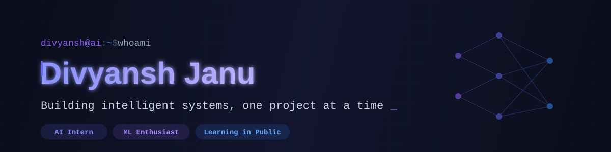

<!-- BANNER -->
<p align="center">
  
</p>

<p align="center">
  <a href="https://linkedin.com/in/divyansh-janu">
    
  </a>
  <a href="https://github.com/Divyanshjanu">
    
  </a>
  <a href="https://divyansh-janu.vercel.app">
    
  </a>
  
</p>

<br/>

## `[ SYSTEM PROMPT ]`

```yaml
role: "AI / Deep Learning Engineer"
education: "Honours Bachelor of Artificial Intelligence @ Durham College"
recent_deployment: "Completed AI Field Placement @ CareerNiche"
base_location: "Ontario, Canada"
portfolio_endpoint: "divyanshjanu.dev"

core_directives:
  - "Build, document, and ship clean, reproducible AI models."
  - "Translate complex mathematical intuitions into functioning neural networks."
  - "Share technical documentation and algorithmic breakdowns openly."

current_focus: 
  - "Advanced Deep Learning: Architecting CNNs and Sequence Models."
  - "Generative AI Engineering: Exploring LLM integrations and optimization."
